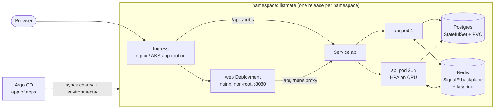

# Platform K8s

[](https://github.com/ahmedoshelmy/platform-k8s/actions/workflows/ci.yml)
[](LICENSE)

Part of the [systems portfolio](https://github.com/ahmedoshelmy/systems-portfolio).

Two small production-style applications, run on Kubernetes the way a team would ship them: Helm charts with
probes, resource limits, non-root read-only containers, HPA, PodDisruptionBudgets and NetworkPolicies; a local
kind cluster for development and CI; value overlays that map the same charts onto AKS; and Argo CD manifests for
GitOps.

| App | Stack | What it shows on Kubernetes |
| --- | --- | --- |
| [listmate](https://github.com/ahmedoshelmy/listmate) | .NET API (SignalR), React web, Postgres, Redis | Horizontal scale-out: two or more API replicas share SignalR messages and the token key ring through a Redis backplane |
| [trip-split](https://github.com/ahmedoshelmy/trip-split) | Spring Boot API (STOMP WebSocket), React web, Postgres | An app that must *not* scale yet: the chart refuses more than one API pod until a broker relay exists |

Extracted from Lingo, a personal assistant app; this repository holds only the platform layer and no app code.

## Architecture



NetworkPolicies (verified on kind, see below): **web** accepts traffic only from the ingress controller's
namespace; **api** only from the ingress controller and the web pods; **Postgres/Redis** only from pods labelled
as that app's API. trip-split has the same layout without Redis, with `/ws` instead of `/hubs`.

## Repository layout

```
charts/listmate      app chart: api + web Deployments, Services, Ingress, ConfigMap, Secret, HPA, PDB, NetworkPolicies
charts/trip-split    same shape, plus an nginx ConfigMap so the web pod runs unprivileged on 8080
charts/postgres      tiny single-instance StatefulSet subchart (dev/CI only, see ADR 0003)
charts/redis         tiny in-memory Redis subchart
environments/dev     values for kind (2 listmate API replicas + Redis, demo data)
environments/aks     prod-like values: managed Postgres/Redis, Key Vault secret, Workload Identity, app routing ingress
gitops/              Argo CD root Application (app of apps), AppProject, one Application per app
kind/cluster.yaml    single-node kind cluster (node image = the kind release's default)
scripts/             validate.sh (lint + kubeconform), up.sh, smoke.sh, down.sh
docs/adr/            decisions: ADRs, Helm vs Kustomize, in-repo stateful deps vs operators, GitOps
```

## Quickstart

Needs Docker (or rootless podman), kind, kubectl, helm 3, jq, and the two app repositories checked out next to
this one (`../listmate`, `../trip-split`).

```bash
scripts/validate.sh                 # helm lint every chart x environment, kubeconform strict on Kubernetes 1.31
scripts/up.sh listmate              # kind cluster, docker build + kind load, helm install, wait
scripts/smoke.sh listmate           # port-forward + curl: health, then register -> login -> create list -> read back
scripts/up.sh trip-split && scripts/smoke.sh trip-split
scripts/down.sh                     # delete the cluster
```

With rootless podman: `export KIND_EXPERIMENTAL_PROVIDER=podman DOCKER_HOST=unix:///run/user/$UID/podman/podman.sock`.
`BUILD=0 scripts/up.sh` reuses images already tagged `localhost/<app>-<tier>:dev`. Images reach the node through
`kind load image-archive`; nothing is pushed to a registry. The kind cluster has no ingress controller, so the
smoke test goes through `kubectl port-forward`; the Ingress objects are still rendered and validated.

## Design notes / talking points

- **Three probes, three questions.** The startup probe gives the API time to run migrations (up to 2 minutes for
  .NET, 3 for the JVM) without a long liveness delay. Liveness asks "is the process stuck?" and checks only the
  process (`/health/live`, Spring's `liveness` group), so a database outage never causes a restart storm.
  Readiness includes the database (`/health/ready`, Spring's `readiness` group), so a pod that lost Postgres is
  taken out of the Service instead of killed.
- **HPA vs. what the app can actually do.** Adding replicas is only safe when the app is stateless *across
  replicas*. listmate keeps SignalR connections in memory, so a write handled by pod B would not reach clients
  connected to pod A, and tokens issued by A would not validate on B. The chart therefore refuses
  (`helm template` fails) to render `replicaCount > 1` or an HPA unless `redisBackplane.enabled` is set, which
  wires both the SignalR Redis backplane and the shared Data Protection key ring. trip-split's STOMP broker is
  in-memory, so its chart refuses to scale at all and uses a `Recreate` strategy so a rollout never runs two
  brokers. The HPA scales in slowly (one pod per 2 minutes, 5-minute window) because WebSocket clients reconnect
  on every scale-in.
- **PDBs only where they can be honoured.** A `minAvailable: 1` budget on a single-replica Deployment blocks node
  drains forever, so PDBs are rendered only for tiers with more than one pod.
- **NetworkPolicies as allow-lists.** Each tier selects its own pods and lists who may connect. The database
  policy is rendered by the subchart from labels the parent chart passes in (`networkPolicy.allowFrom`).
- **Least privilege by default.** Every pod runs as a numeric non-root uid with `readOnlyRootFilesystem`, all
  capabilities dropped, no privilege escalation and the RuntimeDefault seccomp profile; writable paths are
  explicit `emptyDir` mounts. Service account tokens are not mounted. The trip-split web image listens on port 80
  (root), so the chart mounts an equivalent nginx config on 8080 instead of granting `NET_BIND_SERVICE`.
- **Secrets stay out of Git and out of ConfigMaps.** Dev values are obvious placeholders; real clusters set
  `secrets.existingSecret`. The Npgsql connection string is assembled with the kubelet's `$(DB_PASSWORD)`
  expansion, so the full string never sits in a ConfigMap. Config and Secret checksums roll the pods on change.
- **One release per namespace.** The web images proxy to the hostname `api`, so the API Service is called `api`;
  one release per namespace keeps that unique and keeps NetworkPolicies simple.
- **GitOps.** `gitops/root.yaml` is the only object applied by hand; Argo CD syncs the rest with prune and
  self-heal and ignores the HPA-owned `replicas` field. See ADR 0004.
- **Mapping to AKS.** `environments/aks/` swaps the subcharts for Azure Database for PostgreSQL and Azure Cache for
  Redis, reads secrets from Key Vault through the Secrets Store CSI driver, uses Workload Identity and the
  application routing (managed NGINX) ingress class. Details in [environments/aks/README.md](environments/aks/README.md).

## What was verified, and where

Locally (rootless podman, kind v0.25.0, Kubernetes v1.31.2, helm v3.16.3, kubeconform v0.6.7):

- `scripts/validate.sh`: 6 chart x environment combinations lint clean; 81 rendered resources plus 4 Argo CD
  objects valid in strict mode; both scale guard rails fail the render as intended.
- listmate installed with 2 API replicas + Redis; `scripts/smoke.sh listmate` passes (register, login, create a
  list, read it back four times through the web pod's nginx and the `api` Service).
- NetworkPolicies enforced by kindnet: from another namespace, Redis and the web Service time out; inside the
  namespace, a pod with the API's labels gets `PONG` from Redis and an unlabelled pod is blocked.
- trip-split installed and smoke-tested separately: create a trip, add an expense, balances net to zero.
- `scripts/up.sh` + `scripts/smoke.sh` end to end with `BUILD=0` (images built earlier from the app repositories'
  Dockerfiles and tagged `localhost/<app>-<tier>:dev`); one app at a time, cluster deleted afterwards.

In CI only (`.github/workflows/ci.yml`): building the images from the app repositories inside the runner and the
same install + smoke on a fresh kind cluster per app.

Findings from the first installs, now handled in the charts:

- The demo seed password must satisfy the ASP.NET Identity password rules.
- An API pod that started before Redis crashed: the Redis connection string now carries `abortConnect=false`.
- An API pod that started before Postgres had a DNS record crashed: a `wait-for-database` init container
  (`pg_isready`, bounded to 3 minutes, non-root) now gates the API container.
- On a busy node the .NET API crashed with "inotify instances limit reached" (the kind node shares the host's
  `fs.inotify.max_user_instances`). Config files never change inside an image, so the chart sets
  `DOTNET_hostBuilder__reloadConfigOnChange=false` and the file watcher is never created.

After these fixes a fresh trip-split install starts with 0 restarts, and a fresh listmate install with at most one
restart (the demo-seed race below).

## Honest limits

- Not production databases: single-instance Postgres without backups, failover or TLS; in-memory Redis.
- No ingress controller, metrics-server or Argo CD is installed on kind, so Ingress routing, HPA scaling decisions
  and GitOps sync are validated as manifests, not exercised.
- When two listmate API pods start against an empty database with demo data enabled, both try to seed it; one
  loses the unique-key race and restarts once. Seeding belongs in a one-off Job; migrations on AKS are expected to
  run as a pipeline step (`migrateOnStartup: false`), which is not templated here.
- Egress is not restricted.
- No AKS cluster was created; the AKS overlay is rendered and schema-validated only.
